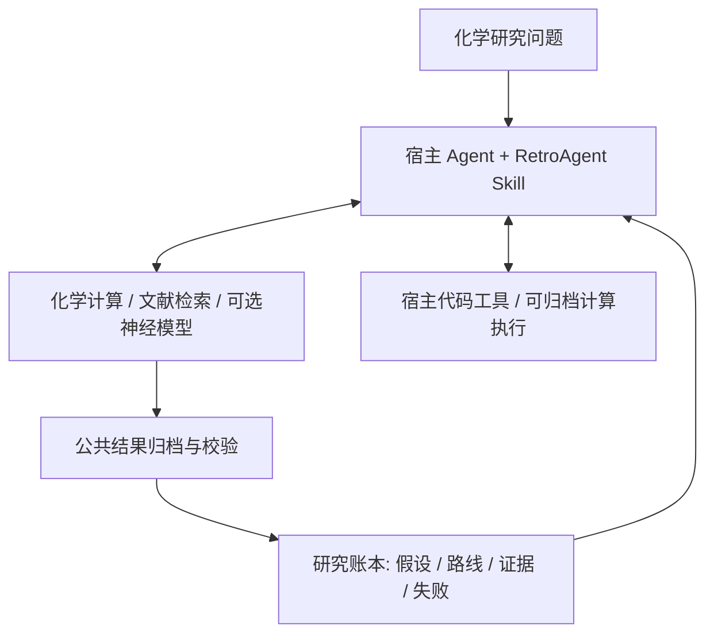

# RetroAgent Skill

**由宿主 Agent 主导的化学研究 Skill。** 这是 `skill` 分支，保留
[main 分支](https://github.com/zhoucanzong/RetroAgent/tree/main) 的独立 Agent 作为兼容模式。

宿主 Agent 负责理解问题、提出假设、选择下一步、解释证据和调整计划。
RetroAgent 提供化学研究方法、可调用工具及可回放的研究状态。
Skill 的正常工作流不会启动另一个 LLM 控制循环，也不要求另配 LLM API key。



## 安装与调用

```bash
git clone --branch skill https://github.com/zhoucanzong/RetroAgent.git
cd RetroAgent
python -m venv .venv
.venv/bin/python -m pip install -e .

# 导出完整 Skill 到宿主支持的技能目录
.venv/bin/retroagent capability skill --output /path/to/host-skills/retroagent
```

也可以让宿主直接加载本仓库的 [skills/retroagent/SKILL.md](skills/retroagent/SKILL.md)。
若宿主使用不同的 Python 环境，将 `RETROAGENT_PYTHON` 指向后端环境的绝对路径。
Skill 内的 `scripts/retro.py` 负责转发命令，不承担研究决策。

向宿主提出具体研究请求，例如：

> 比较这个目标的几种逆合成策略，检查关键步骤的证据，指出当前最值得验证的假设。
> 可以自主选择工具；遇到模型分歧时说明原因，不要把模型排名当作可行性证明。

## 分层内容

| 部分 | 职责 |
| --- | --- |
| `SKILL.md` | 识别研究问题、选择行动、处理负面证据、交付有依据的结论 |
| `references/discovery.md` | 机理分析、路线发现、不确定性与实验选择 |
| `references/models.md` | 三个独立神经预测工具、来源追踪与共识融合 |
| `references/evidence.md` | 记录、检查证据、重试、恢复与结论格式 |
| `references/runtime.md` | 后端安装、CLI/MCP 选择与可选模型环境 |
| Python 后端 | 确定性计算、执行、归档、权限检查与状态恢复 |

正文是人工维护的研究指导；工具参数仍从实际 schema 查询。参考文件按任务需要读取，
不要求把全部工具说明或完整手册加载到上下文。

## 无嵌套 Agent 的研究接口

```bash
.venv/bin/retroagent project init ./study --json
.venv/bin/retroagent research start "分析目标分子的结构与待验证问题" --project ./study --json
.venv/bin/retroagent tool list --json
.venv/bin/retroagent tool call molecule_properties \
  --parameters '{"smiles":"CCO"}' --question "计算有哪些结构描述符？" \
  --project ./study --request-id descriptors-001 --json
.venv/bin/retroagent research context --project ./study --json
.venv/bin/retroagent replay --project ./study --json
```

以上是接口 smoke test，不是新路线发现的证明。复杂输入可使用 `--parameters-file`。
用 `--target ID`、`--question` 和 `--rationale` 把行动关联到已有假设或路线。

工具结果会自动登记反应、路线、证据、实验选择、后验更新、验证报告，以及失败和
重规划事件。CLI 与兼容 Controller 复用同一结果处理代码。
`research finish CONCLUSION.json` 检查证据引用和配置的目标条件，再记录结论；
`research context` 供下一个会话恢复研究，均不调用内部 LLM。

相同 `request_id` 的已完成请求返回历史结果，不重复执行；改动请求内容必须换 ID。
未完成请求不会盲目重试，以免重复外部副作用。结果归档在锁内原子写入；
不应同时用多个旧 Controller 写入同一项目。

## 持久 MCP

```bash
.venv/bin/retroagent mcp serve --project /absolute/path/to/study
```

在宿主中配置该命令启动 MCP 服务，使用：

- `retroagent_tools`：查询工具 schema，不加载 ONNX 或神经权重。
- `retroagent_tool`：在同一个会话进程执行化学工具，保留模型缓存并更新研究状态。
- `retroagent_command`：兼容 CLI 的项目、批量状态写入、查询和导出命令。

后者会启动独立 CLI 进程；重复的重模型预测应使用 `retroagent_tool`。
诊断日志与 JSON 分离，计算失败返回非零 CLI 状态或 MCP `isError=true`。
服务收到 EOF 后释放环境与模型 worker。

## 可选神经模型

| 工具 | 能力 |
| --- | --- |
| `neuralloc_predict` | NeuralLoc 模板选择与作用位置预测 |
| `transformer_predict` | R-SMILES 2 从目标 SMILES 生成前体 |
| `retrochimera_predict` | 上游两模型集成预测 |
| `ensemble_disconnections` | 多来源候选规范化、去重和排名融合 |

这些都是宿主 Agent 自主选择的脚手架，没有固定调用顺序。
输出的 `ensemble_source` 保留 checkpoint 身份；融合器拒绝集成模型与其自身子模型
重复计票。同一环境保留一个活动的神经模型配置，切换时释放旧模型。

真实 CPU 推理、权重来源和环境配置见 [运行指南](docs/retrochimera-cpu.md)。
模型权重不随 Skill 或 wheel 分发。没有神经权重时，仍可使用已有的本地化学计算、
研究状态和其他可用工具。第一次调用缺少依赖的工具会明确失败，不会伪造结果。

## 证据与权限

模型分数、共识、novelty 距离和规则验证结果都不等于实验成功。
信息增益与后验更新依赖输入的先验和似然；没有依据时记录定性判断，不编造数值。
用户提供的观测、检索资料、计算输出和 Agent 假设应保留各自来源。

Skill 不扩大宿主权限，已有明确授权按其范围生效。
后端需要一次性批准时，用户批准后重试原调用即可，不需要 `agent resume`。
账本和检查点仅管理数字状态，不宣称回滚真实实验或外部系统操作。

## 兼容与验证

`agent run/resume` 和原有规划模式保留，用于用户明确要求的独立 Agent 工作流。
Skill 默认使用 `research` 与工具接口；旧研究 ledger 可以读取和回放。

```bash
.venv/bin/python -m unittest discover -s tests -p 'test_*.py'
.venv/bin/python -m compileall -q retroagent scripts skills/retroagent
```

验证覆盖状态一致性、失败归档、重试幂等、审批消费、持久 MCP、延迟模型加载和
Skill bundle 导出。另进行隔离的宿主 Agent 行为测试；软件测试不能代替实验可行性
或未见化学问题的盲测评估。工作记录见 [word.md](word.md)。

## 来源与许可

- [Microsoft RetroChimera](https://github.com/microsoft/retrochimera)：
  神经预测与互补归纳偏置的集成；
  [论文](https://arxiv.org/abs/2412.05269)。
- [AiZynthFinder](https://github.com/MolecularAI/aizynthfinder)：模板、策略与库存工具参考。
- [mini-swe-agent](https://github.com/SWE-agent/mini-swe-agent)：原独立 Agent 控制循环参考。

本项目许可为 [Apache-2.0](LICENSE)。上游项目与模型保留各自许可及归属。

## English

This branch publishes RetroAgent as a host-driven chemistry research Skill.
The host Agent owns planning and interpretation; the backend supplies chemistry
tools, evidence assimilation, persistent state, and optional neural models.
Install the backend from the `skill` branch and export the complete bundle with
`retroagent capability skill --output PATH`. No second LLM API key is required.

Use `research start/context/finish` for host-driven work. Prefer the persistent MCP
`retroagent_tool` for repeated model calls; `retroagent_command` retains CLI
compatibility. The legacy autonomous Controller remains opt-in.
See [SKILL.md](skills/retroagent/SKILL.md) for the research guidance and the linked
references for model use, evidence handling, and runtime setup.
