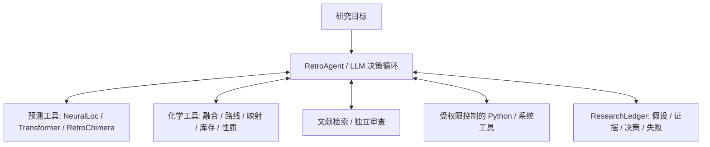

# RetroAgent

<div align="center">

🧪 **化学逆合成路线规划与手性配体设计智能体**
<br>A chemistry agent for retrosynthetic route planning and chiral ligand design

[](LICENSE)

</div>

> 📖 简体中文｜[English version ↓](#-english-version)

RetroAgent 是一个化学研究 Agent：由 LLM 根据研究目标、已有证据和计算预算，自主选择工具、提出假设、比较路线并调整研究方向。逆合成神经模型、化学计算、文献检索、代码执行和研究账本共同构成它的脚手架，支持逆合成规划、手性配体与金属催化剂设计及文献查证。

> **Agent 决定研究策略，脚手架提供预测、计算和证据。** NeuralLoc、R-SMILES 2 Transformer、RetroChimera 都可独立调用；它们不是驱动 Agent 的 LLM，也不会接管研究循环。系统负责权限、预算、状态持久化和配置的完成条件，Agent 可以质疑模型预测、编写分析代码并探索其他路线。

---

## ✨ 核心能力

| 模式                         | 输入            | 核心工具链                                                                                  | 输出                        |
| ---------------------------- | --------------- | ------------------------------------------------------------------------------------------- | --------------------------- |
| **Retrosynthesis**     | 目标分子 SMILES | `disconnect` → `propose` → `evaluate` → `check_stock`                            | 完整合成路线                |
| **Neural Proposals** | 目标分子 SMILES | `neuralloc_predict` / `transformer_predict` / `retrochimera_predict`，由 Agent 选择 | 带来源与排名的候选前体 |
| **Multi-source Fusion** | 多来源候选列表 | `ensemble_disconnections`，可接入路线组合与独立验证 | 共识排序与来源记录 |
| **Ligand Design**      | 自然语言约束    | `design_ligand` → `analyze_chirality` → `classify_ligand`                           | 候选手性配体                |
| **Catalyst Assembly**  | 结构化约束      | `design_catalyst` (配位数/d电子/labile位点计算) → Auditor 审查                           | 金属催化剂描述符 + 事实报告 |
| **Literature Search**  | 查询词          | `web_search` (Crossref/S2/PubChem) → `fetch_url`                                       | 文献命中 + 摘要             |
| **Reaction Mapping**   | 反应 SMILES     | `map_reaction` (rxnmapper 原子映射)                                                       | 原子对原子的成键/断键标注   |
| **Molecule Profiling** | SMILES          | `molecule_properties` + `functional_groups` + `check_patent` + `convert_identifier` | 性质/官能团/可购性/标识符   |
| **Chiral Analysis**    | 任意 SMILES     | `analyze_chirality` + `classify_ligand`                                                 | 手性类型 / R/S / 配位原子   |

---

## 🏗️ 架构



工具间的 ToolGraph 是能力与后续动作提示，不强制模型调用顺序。可选的
`--discovery-v3` 启用更严格的完成条件；它不要求每个任务都调用所有神经模型。

### 架构参考

- **[mini-swe-agent](https://github.com/SWE-agent/mini-swe-agent)**：Agent 控制循环、Environment 协议、异常体系
- **[AiZynthFinder](https://github.com/MolecularAI/aizynthfinder)**：ONNX 策略网络、USPTO 模板库、RDChiral 模板应用、ZINC 库存
- **[Microsoft RetroChimera](https://github.com/microsoft/retrochimera)**：异构归纳偏置模型的 reactant-set 聚合、来源 × 排名加权和 consensus mode。RetroAgent 保留原项目归属，并将该思想扩展到模型、数据库和人工候选的统一 Agent 工具协议

---

## 📁 项目结构

```
retroagent/
├── __init__.py              # 版本、路径配置
├── blackboard.py            # SharedBlackboard 状态容器
├── agents/
│   ├── planner.py           # RetroPlanner (控制循环)
│   └── config.py            # PlannerConfig
├── environments/
│   └── __init__.py          # RetroEnvironment (工具分发器)
├── tools/
│   ├── __init__.py          # RetroTool 协议
│   ├── disconnect.py        # DisconnectionTool (ONNX 推理 + 官能团检测 + 环断裂)
│   ├── propose.py           # ProposalTool (模板应用 + fallback 扫描)
│   ├── evaluate.py          # EvaluationTool (可行性 + 库存评分 + 常用试剂识别)
│   ├── stock.py             # StockTool (ZINC 库存查询)
│   ├── literature.py        # LiteratureTool (模板分类检索)
│   ├── condition.py         # ConditionTool (反应条件推荐)
│   ├── bash_tool.py         # BashTool (subprocess 执行)
│   ├── chirality.py         # ChiralityTool (立体化学分析)
│   ├── ligand_category.py   # LigandCategoryTool (SMARTS 配体骨架分类)
│   ├── conditional_ligand.py # ConditionalLigandTool (模板驱动配体生成)
│   ├── catalyst.py          # CatalystTool (结构化催化剂计算器，只算不判)
│   ├── think.py             # ThinkTool (虚拟推理空间，类似 Claude think tool)
│   ├── web_search.py        # WebSearchTool (免费层文献检索 Crossref/S2/PubChem)
│   ├── fetch_url.py         # FetchUrlTool (URL 抓取 + HTML 清洗)
│   ├── patent.py            # PatentTool (molbloom 可购性/专利检查)
│   ├── functional_groups.py # FunctionalGroupsTool (50+ SMARTS 官能团识别)
│   ├── identifiers.py       # IdentifierTool (PubChem name/IUPAC/CAS ↔ SMILES)
│   ├── properties.py        # PropertiesTool (RDKit 物理化学描述符)
│   ├── reaction_mapper.py   # ReactionMapperTool (rxnmapper 原子映射)
│   ├── retrochimera.py      # RetroChimera 可选适配器 + 多来源排名共识融合
│   └── route_discovery.py   # 路线组合、novelty 与独立验证门控
├── config/
│   ├── default.yaml         # 默认配置（模型路径 + LLM + Agent + Environment）
│   └── config.local.yaml    # 本地覆盖（gitignored，放 API key）
├── loops/                   # Phase 3: Loop Engineering
└── run/
    └── retro.py             # CLI 入口

models/                      # 模型文件平铺存放（不提交到 Git）
├── uspto_model.onnx                       # 扩展策略网络 (2048→42554)
├── uspto_filter_model.onnx                # 反应可行性过滤网络
├── uspto_ringbreaker_model.onnx           # 环断裂专用策略网络
├── full_uspto_truncated_42554.hdf5        # USPTO 模板库（截断到 ONNX 维度）
├── full_uspto_03_05_19_unique_templates.hdf5  # 完整 USPTO 模板库 (46,695 条)
├── uspto_unique_templates.csv             # USPTO 模板库（CSV 格式）
├── uspto_ringbreaker_unique_templates.csv # 环断裂模板库
└── zinc_stock_17_04_20.hdf5               # ZINC 库存 (17.4M InChI Keys)
```

### 模型下载

- https://figshare.com/articles/dataset/AiZynthFinder_a_fast_robust_and_flexible_open-source_software_for_retrosynthetic_planning/12334577
- https://zenodo.org/records/7341155
- https://zenodo.org/records/7797465

模型文件需手动下载并平铺放在 `models/` 目录下：

- **Zenodo 7797465**：`uspto_model.onnx`, `uspto_filter_model.onnx`, `uspto_ringbreaker_model.onnx`
- **Zenodo 7341155**：`uspto_unique_templates.csv.gz`, `uspto_ringbreaker_unique_templates.csv.gz`
- **Figshare 12334577**：`zinc_stock.hdf5`, `full_uspto_03_05_19_unique_templates.hdf5`

> 大文件不提交到 Git，见 `.gitignore`。

### RetroChimera 融合（可选）

RetroAgent 借鉴 [RetroChimera](https://github.com/microsoft/retrochimera) 的核心观察：具有不同归纳偏置的模型通常比同类模型重复采样更互补；对规范化 reactant set 的来源与排名进行加权，可让跨来源共识候选上升，同时保留单一来源的新颖候选。对应论文为 [*Chemist-aligned retrosynthesis by ensembling diverse inductive bias models*](https://arxiv.org/abs/2412.05269)。

```bash
# 安装上游可选依赖；checkpoint 仍需按 RetroChimera 文档单独下载
pip install -e '.[retrochimera]'
export RETROCHIMERA_MODEL_DIR=/absolute/path/to/retrochimera-checkpoint

# 直接调用 RetroChimera 1.3+，保留 constituent ranks/probability
retroagent project init ./my-research
retroagent tool call retrochimera_predict --parameters \
  '{"target_smiles":"CCOC(=O)C","num_results":5,"consensus_only":false}' --project ./my-research --json
```

Apple Silicon CPU 的独立环境、权重来源校验与真实推理复现见
[RetroChimera CPU Inference](docs/retrochimera-cpu.md)。

| Agent 工具 | 模型能力 | 参数 |
| --- | --- | --- |
| `neuralloc_predict` | NeuralLoc 模板选择与作用位置预测 | `model_kwargs`，例如 `num_processes` |
| `transformer_predict` | R-SMILES 2 从目标 SMILES 生成前体 | `model_kwargs`，例如 `beam_size`、`augmentation_size` |
| `retrochimera_predict` | 上游训练好的两模型集成 | `consensus_only`、`submodel_kwargs` |

三个入口共享 `target_smiles / model_dir / num_results / device` 参数。单模型入口接受
集成 checkpoint 根目录并自动定位对应子目录，也接受直接的子模型目录。
输出中的 `ensemble_source` 可以原样放入 `ensemble_disconnections.sources`。
先分别调用两个子模型并比较，再决定是否融合，或直接调用集成模型，均由 Agent 决定。

来源身份 `source_ids` 基于实际 checkpoint 路径保留；融合器拒绝把同一个 checkpoint
的重复调用、改名后的调用，或集成模型与其子模型再次当作独立来源计票。
手工输入仍需如实声明来源；来源标签本身不证明统计独立性。
同一环境的这组三个工具只保留一个活动模型配置，切换时释放旧模型及模板 worker，
重复使用同一配置则复用模型。不同目标的反应使用稳定内容 ID，避免覆盖研究账本。

完成 CPU 环境配置后，可以直接在具备这些模型依赖的环境中启动 Agent：

```bash
export RETROCHIMERA_MODEL_DIR="$PWD/models/retrochimera/pistachio"
.venv/retrochimera/bin/retroagent agent run \
  "比较目标分子的逆合成策略，自主选择预测工具，并列出尚需验证的证据" \
  --project ./my-research
```

没有 checkpoint 时，`ensemble_disconnections` 仍可融合现有模板模型、任意 template-free 模型、数据库检索和人工输入。它先用 RDKit canonical SMILES 合并无序反应物集合，再按校准的 `source × rank` 权重求和；若未提供校准权重，会显式标记使用 reciprocal-rank fallback。`consensus_only=true` 仅保留所有来源共同提出的候选。

融合分数只表示候选排序与来源共识，不表示反应可行性。输出仍需经过 `evaluate / map_reaction / build_route_portfolio / validate_route_portfolio`，并补齐 forward prediction、条件和库存证据。遵循上游风险说明，直接请求默认限制为 5 个、最多 10 个候选；模型权重及 checkpoint 不随 RetroAgent 分发。

---

## 🚀 快速开始

### 环境要求

- Python ≥ 3.10
- RDKit、ONNX Runtime、RDChiral、HDF5、OpenAI SDK

### 安装

```bash
cd RetroAgent
pip install -e .
```

安装后可直接运行 `retroagent --help`。只需依赖文件、不安装命令入口时仍可使用
`pip install -r requirements.txt`。

> 可选：在虚拟环境中安装以隔离依赖（`python3 -m venv .venv && source .venv/bin/activate`），但下面的示例均假设依赖已装好、直接用 `python3` 运行。

> aizynthfinder 的 Python 版本要求 (`<3.13`) 与当前 Python 3.14 不兼容，因此项目通过文件系统直接导入其 `chem` 模块：

```python
import sys
sys.path.insert(0, 'aizynthfinder-master')
from aizynthfinder.chem import TreeMolecule
from aizynthfinder.chem.reaction import TemplatedRetroReaction
```

### 配置

创建本地覆盖文件（已加入 `.gitignore`）：

```bash
cat > retroagent/config/config.local.yaml << 'EOF'
llm:
  api_key: "sk-..."
  model: "deepseek-v4-flash"
  base_url: "https://api.deepseek.com"
EOF
```

或使用环境变量（优先级最高）：

```bash
export LLM_API_KEY="sk-..."
export LLM_MODEL="gpt-4o"
export LLM_BASE_URL="https://api.openai.com/v1"
export RETROAGENT_MODELS_DIR="/absolute/path/to/RetroAgent/models"
```

配置加载优先级：**环境变量 > `config.local.yaml` > `default.yaml`**。

---

## 🛠️ 使用示例

### Agent-native CLI

RetroAgent 使用 `.retroagent/` 项目目录保存 manifest、append-only ledger、运行产物、视图和检查点。
研究实体使用稳定地址，例如 `route:route_0001` 和 `evidence:evidence_0001`。

```bash
# 建立研究项目并查看机器可读命令契约
retroagent project init ./my-research
retroagent help --json
retroagent tool list --json

# 原子写入结构化初始状态；先 dry-run，再提交
retroagent batch actions.json --project ./my-research --dry-run --json
retroagent batch actions.json --project ./my-research --json

# 启动主动发现循环：竞争假设、信息增益实验、后验更新、多来源路线与独立验证
retroagent agent run "寻找并验证一条新的催化路线" --discovery-v3 --project ./my-research
retroagent status --project ./my-research --json
retroagent query evidence --project ./my-research --json
retroagent view route:route_0001 --format html --project ./my-research

# standard 模式下，高风险动作暂停；批准只适用于该次精确动作
retroagent approve --project ./my-research
retroagent agent resume --project ./my-research

# 验证、快照和确定性回放
retroagent validate --project ./my-research --strict --json
retroagent checkpoint create --label before-experiment --project ./my-research
retroagent replay --project ./my-research --json

# 对保存的真实运行轨迹进行事件级闭环评分
retroagent score-discovery-v3 trajectory.json --require-pass
```

`--discovery-v3` 会把完成契约写入 ledger。Agent 至少维护两个竞争假设，先按期望信息增益选择实验，
观测后更新后验，并且只能提交具备多来源 provenance、最低 novelty 分数且通过独立验证门控的路线。
novelty 表示相对参考反应的外推距离，不等同于反应可行性证明。

`restricted / standard / full` 权限语义与 DiscoveryController 一致。`full` 必须显式配置非空
scope；真实实验和外部系统动作不可回滚，`batch` 的原子性仅覆盖研究账本状态。

同一能力 schema 可导出 Agent Skill，并通过内置 MCP stdio server 暴露：

```bash
retroagent capability skill -o /tmp/retroagent-skill/SKILL.md
retroagent capability mcp --json
retroagent mcp serve --project ./my-research
```

### 1. 工具测试（无需 API key）

```bash
PYTHONPATH=. python3 -m retroagent.run.retro test-tools "CC(=O)Oc1ccccc1C(=O)O"
```

### 2. 逆合成规划

```bash
PYTHONPATH=. python3 -m retroagent.run.retro run "CC(=O)Oc1ccccc1C(=O)O"
```

### 3. 手性配体设计

```bash
PYTHONPATH=. python3 -m retroagent.run.retro run \
  "Point chirality ligand with P and O donor atoms" \
  --mode design
```

### 4. 保存轨迹

```bash
PYTHONPATH=. python3 -m retroagent.run.retro run "..." -o /tmp/traj.json
```

---

## 🔄 工作流说明

### 逆合成工作流

```
目标 SMILES
    │
    ▼
search_literature ──▶ 查已知路线
    │
    ▼
disconnect ──▶ 断键建议（带 matching 标志 + 官能团分析）
    │
    ▼
LLM 判断模型预测是否可信 ──┬── 可信 ──▶ propose(model templates)
                             │
                             └── 不可信 ──▶ propose(use_fallback=True)
    │
    ▼
evaluate ──▶ 可行性 + 库存评分
    │
    ▼
check_stock ──▶ 验证原料可及性
    │
    ▼
全部前体 in stock ? 完成 : 递归展开
```

### 手性配体设计工作流

```
自然语言约束
    │
    ▼
design_ligand ──▶ 模板库匹配骨架 + RDKit 取代基枚举（确定性）
    │
    ▼
analyze_chirality ──▶ 验证手性类型 / 立体中心 / R/S
    │
    ▼
classify_ligand ──▶ SMARTS 验证骨架 / 齿数 / 配位原子
    │
    ▼
[金属催化剂] design_catalyst ──▶ 计算配位数 / d电子 / labile位点 / 对称性（只算不判）
    │
    ▼
web_search ──▶ 查证文献先例（Crossref/S2/PubChem，免费）
    │
    ▼
Design Auditor (隔离 sub-agent) ──▶ 事实快照 + 文献对照 → ISSUE + FIX_SUGGESTIONS + VERDICT
    │
    ▼
LLM 根据审查反馈修正并提交
```

> 上下文压缩在每步前自动运行（>60K 字符时老 tool output 压成摘要），让 100 步长任务可持续。

---

## 📊 当前状态

| 阶段      | 状态 | 内容                                                                                                                          |
| --------- | ---- | ----------------------------------------------------------------------------------------------------------------------------- |
| Phase 1.1 | ✅   | 项目骨架 + RetroTool 协议                                                                                                     |
| Phase 1.2 | ✅   | SharedBlackboard 状态容器                                                                                                     |
| Phase 1.3 | ✅   | RetroEnvironment 工具分发器 + BashTool                                                                                        |
| Phase 1.4 | ✅   | 5 个核心 Tool (disconnect/propose/evaluate/stock/literature/condition)                                                        |
| Phase 1.5 | ✅   | RetroPlanner 控制循环 + PlannerConfig + System Template                                                                       |
| Phase 1.6 | ✅   | 集成测试 — aspirin 合成                                                                                                      |
| Phase 1.7 | ✅   | YAML 配置系统 + 模型路径平铺 + OpenAI client                                                                                  |
| Phase 1.8 | ✅   | 手性配体设计扩展：ChiralityTool / LigandCategoryTool / ConditionalLigandTool                                                  |
| Phase 1.9 | ✅   | 环断裂策略网络 + 模板库接入                                                                                                   |
| Phase 2   | ✅   | LLM 驱动端到端规划（逆合成 + 配体设计均已跑通）                                                                               |
| Phase 3   | ✅   | Loop Engineering: Think Tool + Dead-Loop Monitor + Enhanced Observation + Adaptive Scaling + Branch Tracking + Design Auditor |
| Phase 4   | ✅   | Claude 哲学重构: 隔离 Auditor sub-agent + design_catalyst 计算器 + classify_ligand SMARTS 修复 + 上下文压缩                   |
| Phase 5   | ✅   | 模型侧优化: design_ligand 模板化 + 全免费层 web_search/fetch_url + 文献接地的审查                                             |
| Phase 6   | ✅   | 集成: check_patent/functional_groups/convert_identifier/molecule_properties/map_reaction + examples 元数据增强                |
| Research Agent | 已实现 | DiscoveryController、证据账本、主动实验选择、后验更新、可选 v3 完成条件 |
| Agent CLI | 已实现 | 项目、审批、回放、检查点、JSON 与 MCP 工具接口 |
| Neural Scaffolding | 已验证 | 三个独立模型入口、来源去重、真实 CPU 推理及候选融合 |

2026-09-27：原开发环境与神经推理环境均通过 192 项回归测试；NeuralLoc 与
Transformer 独立调用各生成 5 个候选，其真实输出可直接融合。完整集成模型也已跑通。
这些验证确认软件运行与接口兼容；新路线的实验可行性和未见化学问题上的泛化仍需独立评估。

---

## 🧠 关键设计决策

1. **Tool 不做策略决策**：`propose(use_fallback=True)` 由 LLM 决定是否调用，Tool 不自动 fallback
2. **Tool 诚实报告质量**：`disconnect` 返回 `matching` 标志 + 官能团分析，让 LLM 交叉验证
3. **ONNX 模型仅作为弱信号**：USPTO 训练数据偏向复杂药物分子，对简单目标预测不准。LLM 可通过化学知识绕过模型
4. **LLM 不必微调**：Outer Loop 只更新 Tool 内部模型参数，LLM 保持通用推理能力
5. **兼容非原生 tool-calling 的模型**：LLMClient 同时支持 OpenAI `tool_calls` 和文本 JSON 块解析，适配 DeepSeek 等模型
6. **Think Tool — 显式推理空间**：借鉴 Claude 的 extended thinking 设计。`think` 工具是纯文本、无副作用的虚拟工具，让模型在调用实际化学工具前"停下来思考"。思考内容以 `<thinking>` 标签注入对话历史。不计入 iteration count
7. **Dead-Loop Monitor — 防死循环安全网**：5 个纯启发式检测器（无 LLM 调用）：Tool-Type Cycling、Semantic Repeat、Stagnation Timer、Early Exit Hint、Evaluate Loop。步数提高到 100+ 后防止浪费
8. **Mode-Aware Auditing**：Retrosynthesis 模式有 Peer Reviewer（6 维度路线审核），Design 模式有 Design Auditor（6 维度催化剂设计审核：对称性、配位饱和、手性来源、辅助配体、文献可比性、氧化态）。Auditor 给出 ISSUE + FIX_SUGGESTIONS + AUDIT_VERDICT
9. **Adaptive Scaling**：RDKit 分析分子复杂度，自动调整 step_limit（简单≤30 / 中等≤100 / 复杂≤150）
10. **Branch Tracking Table**：动态注入分支探索状态表（Markdown 表格），防止长链路中丢失探索目标
11. **Tool 只计算，Model 才判断**（Claude 哲学核心）：`design_catalyst` 只报告事实（配位数、d 电子、labile 位点、对称性候选、氧化态合理性），**绝不**返回 REJECT/APPROVE。化学判断完全在 LLM (Auditor) 里
12. **独立视角用全新上下文 sub-agent**：Auditor / Peer Reviewer 不在主对话里切换角色（会自我锚定），而是跑在 2 条消息的隔离快照上下文——只看事实，不看主 agent 的推理过程。审查质量是系统瓶颈，值得这次 LLM 调用
13. **结构化表示解决表示问题**：金属配合物不用单一 SMILES（RDKit/LLM 都难写），改用结构化描述符（有机配体 SMILES + 金属/氧化态/几何 + 每配体齿数/供体原子/数量）。`design_catalyst` 据此计算事实
14. **上下文工程 > 加代码**：100 步长任务靠 `_compact_messages()` 支撑——老的 tool output 压成一行摘要，保护 thinking 块、审查 verdict、提交信号、最近 8 条工作窗口（幂等）
15. **确定性模板生成 + 外部知识获取**：`design_ligand` 用 12 个家族的真实代表性 SMILES 库 + RDKit 取代基枚举（确定性，不依赖 LLM 随机性）；`web_search` 用免费层（Crossref/Semantic Scholar/PubChem，无需 key）让 agent 能查证文献
16. **文献接地的审查**：审查前主动 web_search 拉相关文献，作为事实注入隔离快照。Auditor 同时看设计事实 + 真实先例，在一个隔离调用里判断（不让审查器自己调工具，保持单次调用）
17. **SMARTS 子结构匹配**：`classify_ligand` 用最小特征 SMARTS（any-bond `~` 匹配）而非完整 SMILES，BINAP 现在能匹配 BINAP；N,N'-二氧化物需 ≥2 个 N-oxide 才确认
18. **ZINC 局限性诚实标注**：ZINC 是虚拟筛选化合物库（17.4M 类药分子），不含 NaBH₄/Pd 催化剂/常用溶剂等试剂。`evaluate` 内置常用试剂 SMARTS 白名单，ZINC 查询前先识别，避免假阴性误导
19. **分子分析与验证工具集**：`check_patent`(molbloom 可购性)、`functional_groups`(50+ SMARTS)、`convert_identifier`(PubChem name/IUPAC/CAS↔SMILES)、`molecule_properties`(RDKit 物理化学描述符)、`map_reaction`(rxnmapper 原子映射)——覆盖专利/官能团/标识符/性质/反应机理五个维度，全部零成本（本地或免费 API）
20. **`examples` 元数据增强工具调用可靠性**：结构化输入易错的工具（`evaluate`/`design_ligand`/`design_catalyst`/`convert_identifier`/`map_reaction`）配 Input→Output 示例，渲染进 system prompt，提升首次调用参数正确率（上下文工程）

---

## 🌐 English Version

> This is the English version of the Chinese README above. The two are kept in sync; the Chinese version is authoritative.

**RetroAgent** is a chemistry research Agent. Its LLM chooses research actions using the goal, evidence, and budget. Prediction models, chemistry calculators, literature retrieval, code execution, and a replayable ledger form its scaffolding. These capabilities support retrosynthesis, ligand and catalyst design, and literature verification.

> **The Agent owns the research strategy.** NeuralLoc, the R-SMILES 2 Transformer, and RetroChimera are optional prediction tools, distinct from the Agent's LLM. ToolGraph links are suggestions; the Agent may compare, reject, combine, or move beyond their predictions. Permissions, budgets, and configured completion criteria are enforced by the runtime.

### Core Capabilities

| Mode | Input | Core tool chain | Output |
| --- | --- | --- | --- |
| **Retrosynthesis** | target SMILES | `disconnect` → `propose` → `evaluate` → `check_stock` | complete synthetic route |
| **Neural Proposals** | target SMILES | Agent chooses `neuralloc_predict`, `transformer_predict`, or `retrochimera_predict` | ranked precursor candidates |
| **Multi-source Fusion** | ranked candidates | optional `ensemble_disconnections`, followed by Agent-selected checks | consensus ranks and provenance |
| **Ligand Design** | natural-language constraints | `design_ligand` → `analyze_chirality` → `classify_ligand` | candidate chiral ligands |
| **Catalyst Assembly** | structured constraints | `design_catalyst` (coordination/d-electron/labile-site calc) → Auditor review | metal-catalyst descriptor + fact report |
| **Literature Search** | query | `web_search` (Crossref/S2/PubChem) → `fetch_url` | literature hits + abstracts |
| **Reaction Mapping** | reaction SMILES | `map_reaction` (rxnmapper atom mapping) | atom-to-atom bond labels |
| **Molecule Profiling** | SMILES | `molecule_properties` + `functional_groups` + `check_patent` + `convert_identifier` | properties / FGs / purchasability / identifiers |
| **Chiral Analysis** | any SMILES | `analyze_chirality` + `classify_ligand` | chirality type / R,S / donor atoms |

### Architecture

The LLM controls the research loop. DiscoveryController records decisions, authorizes actions, executes tools, and assimilates results into ResearchLedger. Isolated reviewers can inspect factual snapshots; computational predictions remain proposals requiring evidence. Legacy planning modes also use the shared blackboard.

Architectural references: **[mini-swe-agent](https://github.com/SWE-agent/mini-swe-agent)** (agent loop, environment protocol), **[AiZynthFinder](https://github.com/MolecularAI/aizynthfinder)** (ONNX policy, USPTO templates, RDChiral, ZINC stock), and **[Microsoft RetroChimera](https://github.com/microsoft/retrochimera)** (reactant-set aggregation, source-by-rank weighting, and consensus mode across complementary inductive biases).

### Optional RetroChimera Integration

Install `pip install -e '.[retrochimera]'`, download an upstream checkpoint separately, and set `RETROCHIMERA_MODEL_DIR`. The `retrochimera_predict` tool calls RetroChimera 1.3+ while preserving constituent ranks and metadata. The model-independent `ensemble_disconnections` tool applies the same rank-weighted consensus protocol to any combination of models, database hits, and human proposals. See [the RetroChimera repository](https://github.com/microsoft/retrochimera) and its [paper](https://arxiv.org/abs/2412.05269).

`neuralloc_predict` and `transformer_predict` also expose the constituent models independently.
Single-model tools accept the ensemble root or component directory and `model_kwargs`.
Pass returned `ensemble_source` objects unchanged to the fusion tool; overlapping checkpoint
identities are rejected to prevent double counting. One active model configuration is retained
per environment across these three tools. See the [tested CPU setup](docs/retrochimera-cpu.md)
for the full neural runtime dependencies and executable examples.

Ensemble scores express agreement and ranking, not chemical feasibility. Every candidate remains subject to RetroAgent's independent mapping, forward-prediction, condition, stock, route, and expert-review gates. RetroChimera checkpoints and weights are not redistributed by this project.

### Quick Start

```bash
cd RetroAgent
pip install -r requirements.txt

# 1. Test tools (no API key needed)
PYTHONPATH=. python3 -m retroagent.run.retro test-tools "CC(=O)Oc1ccccc1C(=O)O"

# 2. Retrosynthesis
PYTHONPATH=. python3 -m retroagent.run.retro run "CC(=O)Oc1ccccc1C(=O)O"

# 3. Ligand/catalyst design
PYTHONPATH=. python3 -m retroagent.run.retro run \
  "Point chirality ligand with P and O donor atoms" --mode design

# 4. Save trajectory
PYTHONPATH=. python3 -m retroagent.run.retro run "..." -o /tmp/traj.json
```

Configuration priority: **env vars > `config.local.yaml` > `default.yaml`**. Set `LLM_API_KEY` / `LLM_MODEL` / `LLM_BASE_URL`, or create `retroagent/config/config.local.yaml` with `llm.api_key`. Model files (ONNX/HDF5/ZINC) must be downloaded separately into `models/` — see the Chinese section above for the download links.

### Design Philosophy (in brief)

1. **Tools compute, the model judges** — e.g. `design_catalyst` reports coordination number / d-electrons / labile sites / symmetry candidates and **never** returns REJECT/APPROVE; the LLM (Auditor) interprets.
2. **Independent review via fresh-context sub-agents** — the Auditor/Reviewer run on a 2-message isolated snapshot (facts only), never on the main conversation, so reviews aren't anchored by the agent's own reasoning.
3. **Structured representation for hard cases** — metal complexes are described as organic-ligand SMILES + metal/geometry fields rather than a single organometallic SMILES.
4. **Context engineering over more code** — a `think` tool for explicit reasoning, dynamic branch-tracking tables, and idempotent context compaction keep 100-step runs viable.
5. **Deterministic generation + free-tier retrieval** — `design_ligand` uses a curated scaffold library + RDKit enumeration; `web_search` uses Crossref / Semantic Scholar / PubChem (no API key).
6. **Mode-aware auditing with literature grounding** — the Auditor gets real papers fetched up front and judges designs against them.

See the Chinese "关键设计决策" section above for the full list (20 points).

### Current Status

The project includes DiscoveryController, replayable research evidence, active-learning tools,
an Agent-native CLI/MCP interface, and three independently callable neural prediction tools.
On 2026-09-27, both Python environments passed 192 regression tests. Real NeuralLoc and
Transformer calls each produced five candidates, and their outputs were successfully fused.
The combined RetroChimera model also completed real CPU inference. These are software and
integration checks; experimental feasibility and generalization to unseen chemistry require
separate evaluation.

---

## 📜 License

Licensed under the Apache License, Version 2.0. See [LICENSE](LICENSE) for details.
